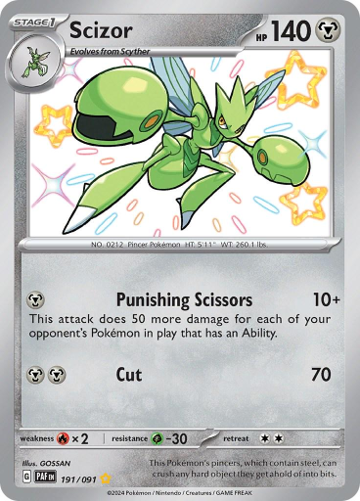
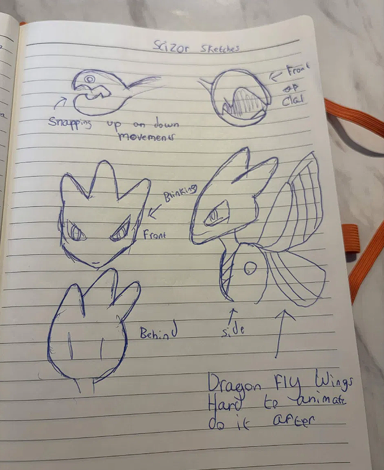
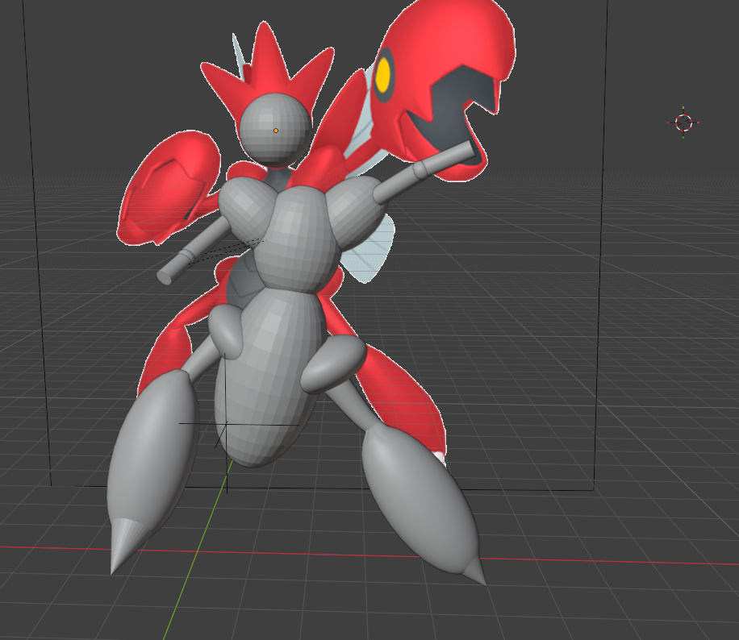
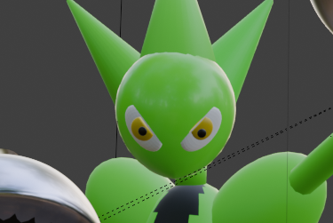
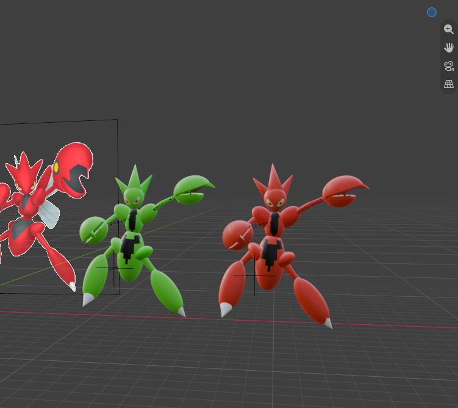

}

## **Render- Ryan Anderson**

Insert final photo here

## **My idea**
My Render shows my favourite pokemon scizor in a fight with another variant of pokemon, I wanted my render to caputre an action shot , with alot happening focusing more on the moves / body movements than background.

All designs beloong to the pokemon company , All models and scenes are my own work created using blender.

## ** 1.Refrence and original paper sketches**

I used some of the pokemon cards i have , plus official artwork for refrence then sketched the body shapes and parts on paper.

 

*Left: pokemon card ref. right: first paper sketch*

## **2.Modeling**

### **v1-Body**

The base model was built with a mix of Uv Shpheres / cylinders that were positioned to correctly match the refrence.

Started with attempting to build a basic version of the legs and torso . then later moved onto the head and used a spehere and 3 cones to make the base of the model.
 
I also had to add elbow joints so the skeleton could be easily animated later

I decided to leave the wings to be modeled later as i wasnt to sure how i was gonna animate them yet and i thought that it would be better to create them once i had a more solid idea as they were going to be the hardest part.

 

*Left: First attempt at a good looking body . right: Head Completed*

### **v2-claws and background testing**

Starting Creating the claws using a UV shpere then bisceting it in half and then doing the same for the bottom hinge. Then for the claws i copy pasted the claws on the feet flattended them and moved them onto the claw and set the claw as the parent so it could all be moved together , i also attached the claw to the upper forearm so it could be moved as one unit.

i Then copy pasted the claw onto the other arm.

Then i tested a simple grass background by adding a plane below and giving it the hair particle system and adjusted the count and hair to look like grass.  It looked really good but every time i rendered it my computer would almost crash and the file size grew large so i left it out until the final rendor.

### **v3-Second character and main model finished (apart from wings)**

Because i want to make this an action seen i copy pasted the finished model changing the pose using the leg/ arm joints i made earlier adn then changed the material to a lime green (making it a shiny variant) this was to make it a ovbious different model.

Eyes will simply made by flattening two small uv spheres and changing there color to white and black.

  

